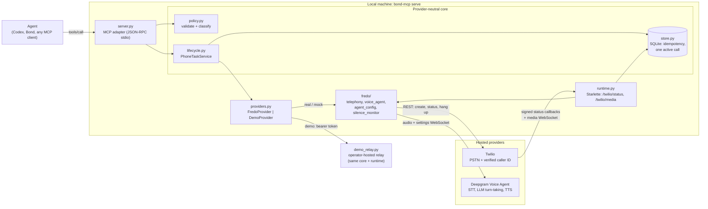
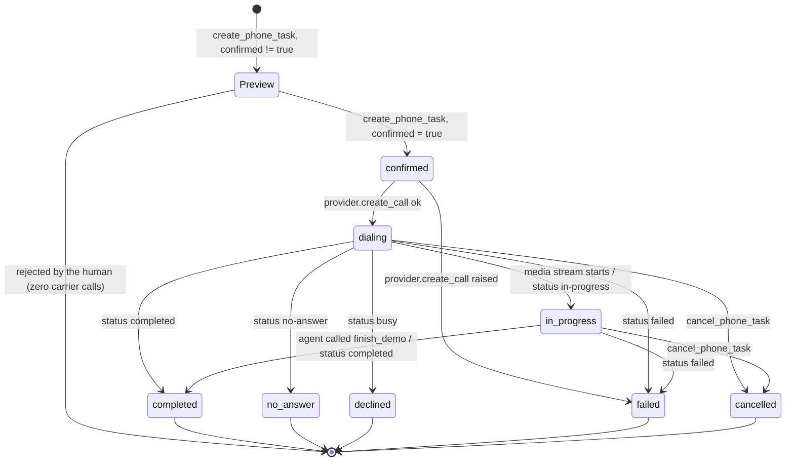

# Architecture

Bond-OpenAI turns "this task needs a phone call" into one consented, verified,
time-boxed call whose outcome comes back to the agent as structured data. This
page describes the code as it is today: what each module owns, how a call moves
through its states, what runs where, and where every safety rule is enforced.

## Components

| Layer | Module | Owns |
| --- | --- | --- |
| Transport adapter | `bond_mcp/server.py` | MCP methods, tool schemas, result envelopes, error codes. No safety logic. |
| Transport adapter | `bond_mcp/demo_relay.py` | Bearer-token HTTP API for the zero-credential demo, rate limiting. Delegates to the core. |
| Transport adapter | `bond_mcp/cli.py` | `serve`, `relay`, `doctor`, `install`, `demo configure`. Never overwrites files without `--force`. |
| Core | `bond_mcp/policy.py` | Task validation (`build_task`), E.164 normalisation, allowlist, consent, classification. |
| Core | `bond_mcp/lifecycle.py` | `PhoneTaskService`: preview, dial, status, cancel; provider status mapping. |
| Core | `bond_mcp/store.py` | SQLite persistence, idempotency keys, single-active-call guard. |
| Core | `bond_mcp/models.py` | `PhoneTask`, `PhoneResult`, `TaskState`, `TERMINAL_STATES`. |
| Provider seam | `bond_mcp/providers.py` | `PhoneProvider` protocol; `FredoProvider` (local runtime) and `DemoProvider` (relay client). |
| Carrier runtime | `bond_mcp/runtime.py` | Twilio status callback and media WebSocket endpoints; binds the store to a voice session. |
| Carrier runtime | `fredo/telephony.py` | Twilio REST calls (`place_call`, `get_status`, `hangup`), TwiML, `MockTelephony`. |
| Carrier runtime | `fredo/voice_agent.py` | Bridges one Twilio media stream to one Deepgram Voice Agent session. |
| Carrier runtime | `fredo/agent_config.py`, `fredo/silence_monitor.py` | Agent prompt, disclosure greeting, endpointing; reprompt-then-hang-up on silence. |
| Configuration | `fredo/settings.py` | Environment parsing with fail-closed bounds; secrets excluded from `repr`. |

The core imports no transport and no vendor SDK (pinned by
`test_core_imports_no_transport_or_vendor_sdk`). Swapping Twilio or Deepgram
means a new `PhoneProvider`; adding a transport means a new adapter over
`PhoneTaskService`.

## Call lifecycle

`bond.create_phone_task` is called twice by design: first without
`confirmed: true` to obtain a preview (nothing is stored, nothing is dialed),
then with `confirmed: true` and the same `idempotency_key` after a human
approves that preview.

- `confirmed` is written by `TaskStore.reserve` inside `BEGIN IMMEDIATE`, before
  the provider is contacted.
- Status changes arrive from three sources: Twilio status callbacks
  (`runtime.status`), polling through `get_phone_task_status`
  (`PhoneTaskService.status`), and the voice session (`media` sets `in_progress`,
  the `finish_demo` function sets `completed` with a summary).
- Terminal states (`completed`, `no_answer`, `declined`, `failed`, `cancelled`)
  are never overwritten by callbacks or polling.
- `TaskState` also declares `detected`, `needs_input` and `ready_for_review` for
  the published schema; the current code returns those situations as tool
  responses (`classification`, `needs_input` error, `needs_confirmation`
  preview) rather than persisted rows.

## Trust boundaries

| Runs | Where | Sees |
| --- | --- | --- |
| MCP server, policy, store, CLI | Local process, stdio only | Task input, allowlist, local SQLite under `FREDO_STATE_DIR` |
| Carrier runtime (`runtime.py`) | Local HTTP server on `FREDO_HOST:FREDO_PORT`, reachable by Twilio only through the operator's `FREDO_PUBLIC_URL` | Signed callbacks, call audio in transit |
| Twilio | Hosted | Destination number, caller ID, call audio |
| Deepgram Voice Agent | Hosted | Call audio, call goal (in the prompt), transcripts during the call |
| Demo relay | Operator-hosted | Confirmed task payloads; holds the Twilio/Deepgram keys so clients do not |

Untrusted inputs and how they are handled:

- **Agent task input**: validated by `policy.build_task`; it cannot choose the
  caller ID, recording, or duration.
- **The person on the call**: treated as untrusted data by the agent prompt;
  the only callable function is `finish_demo`, anything else returns
  `unsupported_function`.
- **Inbound HTTP/WebSocket**: Twilio signature or endpoint secret required on
  status callbacks; Twilio signature required on the media stream when
  `TWILIO_AUTH_TOKEN` is set; bearer token plus rate limit on the relay.

Speech recognition, dialogue and synthesis are hosted by Deepgram. Nothing in
this repository performs local inference.

## Safety invariants

| Invariant | Enforced in |
| --- | --- |
| Explicit recipient consent (`consent_confirmed` must be literal `true`) | `policy.build_task` |
| Canonical E.164 destination on an exact allowlist; invalid allowlist entries fail at startup | `policy.normalize_phone`, `Policy.__post_init__`, `policy.build_task`; re-applied by the relay |
| Human confirmation before dialing; rejecting the preview means zero carrier calls | `server.McpServer._create` (preview), `lifecycle.PhoneTaskService.dial` (`confirmation_required`) |
| Idempotent creation: key required, exact replay returns the stored result, changed payload is rejected | `server.McpServer._create`, `store.TaskStore.reserve` (`IdempotencyConflict`) |
| No blind redial after an uncertain or failed carrier attempt | `lifecycle.PhoneTaskService.dial` records `failed`; a replay returns it without calling the provider |
| One active call at a time, across processes | `store.TaskStore.reserve` (`BEGIN IMMEDIATE`, `ActiveCall`); `Settings.from_env` pins `FREDO_MAX_CONCURRENT_CALLS=1` |
| 180-second hard cap, enforced twice | `Settings.from_env` (10 to 180 s); Twilio `time_limit` in `TwilioTelephony.place_call`; `VoiceAgentSession._duration_guard` |
| Verified caller identity only | `TwilioTelephony.place_call` uses the operator's `TWILIO_PHONE_NUMBER`; no task field overrides it ([ADR 0001](decisions/0001-verified-caller-identity.md)) |
| Recording disabled and disclosed | No recording parameter on `calls.create`; `PhoneResult.recorded` is `false`; greeting in `agent_config.build_agent_settings`; barge-in suppressed during disclosure in `VoiceAgentSession` |
| Authenticated carrier callbacks | `runtime.status` (Twilio signature or constant-time endpoint secret), `runtime.media` (Twilio signature), `fredo.security.validate_twilio_signature` |
| Secrets, transcripts and provider IDs stay out of results and logs | `Settings` fields with `repr=False`, `Settings.public_summary`, `PhoneResult.as_dict` drops `provider_call_id`, transcripts are not retained by `runtime.media` |

Each invariant has an offline test under `tests/` (`test_policy.py`,
`test_lifecycle.py`, `test_mcp_server.py`, `test_demo_relay.py`,
`test_runtime.py`, `test_settings.py`, `test_telephony.py`,
`test_voice_agent.py`). None of them touches the network.

## Deliberate limits

- One call at a time and a short cap: this is a guarded action, not a dialer.
- Status is eventually consistent: callbacks and polling can both update a row;
  the terminal-state rule makes the first terminal value win.
- The SQLite store is local to one machine; the relay keeps its own store.
